# JanaМен — единая HR-платформа Jana Post

> **Terricon Valley × Jana Post · PostTech Hackathon 2026 · Challenge 02 «Digital HR»**
>
> Один вход — и у сотрудника в одном окне профиль из 1С:ЗУП, заявки на отпуск и аванс со статусом и историей,
> обучение в Jana Academy, задачи, объявления, уведомления и HR-ассистент **AI Jana**, который отвечает только по базе
> знаний и всегда показывает источник. У руководителя — согласования и команда, у HR — «Пульс компании»:
> аналитика, прогнозы, зона внимания и очередь эскалаций.

**Демо-стенд: [janamen.onrender.com](https://janamen.onrender.com)** — на экране входа есть кнопки входа в один клик
для каждой роли (пароль тестовых аккаунтов `Jana2026!`). На стенде AI Jana работает в режиме базы знаний; режим с
языковой моделью — в Docker или на Vercel с `ANTHROPIC_API_KEY`.

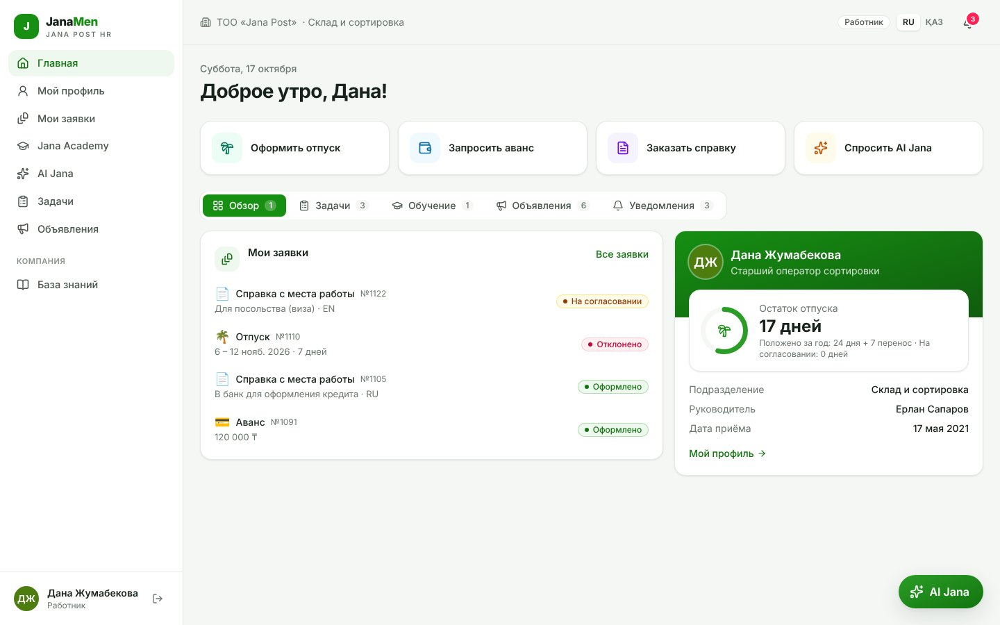

**Сквозной путь из кейса:** `Вход и роль → Профиль → Заявка → Обучение → HR-ассистент`
— заявка «Отпуск»/«Аванс» → статус, история и уведомление; курс → прогресс и результат в профиле; ответ ассистента → ссылка на источник.

## Содержание

- [Быстрый старт](#быстрый-старт)
- [Тестовые учётные записи](#тестовые-учётные-записи)
- [Сценарии демонстрации](#сценарии-демонстрации)
- [Что умеет каждая роль](#что-умеет-каждая-роль)
- [AI Jana](#ai-jana)
- [Интеграции с 1С:ЗУП и Documentolog](#интеграции-с-1сзуп-и-documentolog)
- [Архитектура](#архитектура)
- [Роли и права доступа](#роли-и-права-доступа)
- [Что реализовано, что смоделировано, что дальше](#что-реализовано-что-смоделировано-что-дальше)
- [Безопасность и данные](#безопасность-и-данные)
- [Тесты](#тесты)
- [Примечание: пожелания команды](#примечание-пожелания-команды)
- [Структура репозитория](#структура-репозитория)

## Быстрый старт

### Вариант A. Docker — весь стек локально одной командой

Нужен только Docker (Compose v2).

```bash
git clone https://github.com/mokydek/TerriconValleyDigitalHR.git
cd TerriconValleyDigitalHR
docker compose up --build
```

Откройте **http://localhost:8080** и нажмите одну из кнопок демо-входа. Поднимаются Postgres, Supabase Auth (GoTrue),
PostgREST и веб-шлюз (SPA + `/api/ai-jana`); схема, политики доступа и демо-данные применяются автоматически.
Секреты (JWT, пароли БД) генерируются при первом запуске в docker-томе — в репозитории их нет.

| Нужно | Команда |
|---|---|
| AI Jana с языковой моделью (иначе — режим «строго по базе знаний») | `ANTHROPIC_API_KEY=… docker compose up --build` |
| Сбросить демо-данные перед показом | `SEED=always docker compose up -d init` |
| Другой порт | `PORT=3000 docker compose up --build` |
| Удалить всё вместе с данными | `docker compose down -v` |

### Вариант B. Supabase Cloud + Vercel (публичный стенд)

1. **База.** Supabase → *SQL Editor* → *New query* → вставьте файл [`supabase/setup.sql`](supabase/setup.sql) целиком → *Run*.
   Это все миграции + демо-данные одним файлом; скрипт можно запускать повторно (так же сбрасывается стенд).
   Через CLI то же самое: `npx supabase init` → `npx supabase link --project-ref <ref>` → `npx supabase db push --include-seed`.
2. **Auth.** *Authentication → Sign In / Providers*: выключите *Allow new users to sign up* — учётные записи создаёт HR
   по данным 1С:ЗУП (в демо — четыре тестовых пользователя).
3. **Фронтенд.** Vercel → *Add New → Project* → импортируйте репозиторий (фреймворк Vite определится сам) и задайте переменные:

   | Переменная | Значение | Обязательно |
   |---|---|---|
   | `VITE_SUPABASE_URL` | `https://<project-ref>.supabase.co` | да |
   | `VITE_SUPABASE_ANON_KEY` | anon / publishable key из *Project Settings → API* | да |
   | `ANTHROPIC_API_KEY` | ключ Claude API для LLM-режима AI Jana | нет |
   | `ANTHROPIC_MODEL` | по умолчанию `claude-opus-5-5` | нет |
   | `ANTHROPIC_EFFORT` | `low` / `medium` / `high`, по умолчанию `low` | нет |

   Публичные `VITE_*` попадают в браузер — доступ к данным ограничивают политики RLS в базе.
   `ANTHROPIC_API_KEY` используется только серверной функцией `api/ai-jana.ts`.

### Вариант C. Разработка

```bash
npm ci
cp .env.example .env.local   # укажите VITE_SUPABASE_URL и VITE_SUPABASE_ANON_KEY
npm run dev                  # http://localhost:5173
```

В `vite dev` серверной функции нет, поэтому AI Jana работает в режиме базы знаний; LLM-режим — на Vercel или в Docker.
Node.js ≥ 20.19.

## Тестовые учётные записи

Пароль у всех: **`Jana2026!`** (вымышленный демо-стенд). На экране входа есть кнопки входа в один клик.

| Почта | Роль | Персонаж | Что посмотреть |
|---|---|---|---|
| `employee@jana.test` | Работник | Дана Жумабекова, старший оператор сортировки | заявки, курс по ИБ, AI Jana, уведомления |
| `manager@jana.test` | Руководитель | Ерлан Сапаров, руководитель склада и сортировки | согласования, «Моя команда», аналитика команды |
| `hr@jana.test` | HR / администратор | Айгерим Нурланова, HR-директор | «Пульс компании», канбан, сотрудники, аналитика, обращения, интеграции |
| `newbie@jana.test` | Работник (новичок) | Тимур Ахметов, 5-й день в компании | онбординг: адаптационный курс, задачи наставника |

В демо-наборе 35 сотрудников в 11 подразделениях, ~120 заявок за полтора года (для трендов и прогнозов), 4 курса,
18 статей базы знаний, задачи, объявления, обращения в HR и логистические показатели. Все данные вымышленные.

## Сценарии демонстрации

Шесть ключевых сценариев из кейса — что нажать и что при этом гарантирует сервер.

**1. Работник входит и видит всё в одном окне.** `employee@jana.test` → главная: приветствие (RU/ҚАЗ), быстрые сервисы
(отпуск, аванс, справка, вопрос AI Jana), остаток отпуска, мои заявки, моё обучение, задачи, объявления, уведомления.
«Мой профиль» — Ф.И.О., компания, должность, подразделение, руководитель, дата приёма, остаток отпуска, обучение;
официальные поля помечены «из 1С:ЗУП» и не редактируются (запрет на уровне триггера БД).

**2. Заявка на отпуск или аванс и смена статуса.** «Оформить отпуск» → даты → система сразу считает дни (праздники РК
не входят), показывает остаток и маршрут согласования → «Отправить». Заявка появляется в «Моих заявках» с номером,
статусом и историей. Дальше: руководитель согласует → HR оформляет в один клик → событие уходит в 1С:ЗУП и Documentolog
→ статус «Готово», в карточке — номер приказа и документ. Каждый шаг — запись в истории и уведомление.
Проверки на сервере: баланс отпуска, аванс не больше 50 % оклада и не чаще раза в месяц, отказ только с комментарием.

**3. Руководитель видит только свою команду.** `manager@jana.test`: «Ждут вашего решения» с таймером ожидания,
«Моя команда» (кто в отпуске, обучение, задачи), аналитика по своему подразделению. Чужие заявки, оклады, ИИН и
аналитика компании недоступны — это обеспечивают политики RLS в Postgres, а не скрытые кнопки
(проверяется тестом `tests/api-smoke.mjs`).

**4. Курс в Jana Academy.** «Jana Academy» → назначенный курс «Информационная безопасность…» → уроки отмечаются
пройденными, прогресс растёт → тест. Баллы считает сервер (ключи ответов клиенту недоступны), при успехе — сертификат,
результат виден в профиле, руководителю и HR; уведомления о назначении и завершении.

**5. Типовой вопрос к AI Jana — ответ со ссылкой на источник.** «Как оформить аванс?», «Сколько у меня дней отпуска?»
→ ответ по базе знаний или по личным данным, под ответом — источник (документ и раздел), по клику открывается статья.

**6. Вопрос вне базы знаний.** «Когда корпоратив?» → «В базе знаний нет надёжного ответа… могу передать вопрос в HR»
→ кнопка «Задать вопрос HR». Обращение попадает в очередь HR; ответ приходит сотруднику уведомлением, а HR одной галочкой
добавляет его в базу знаний — в следующий раз AI Jana ответит сама. Просьба раскрыть чужие данные
(«Какая зарплата у моего руководителя?») — вежливый отказ.

<table>
<tr>
<td>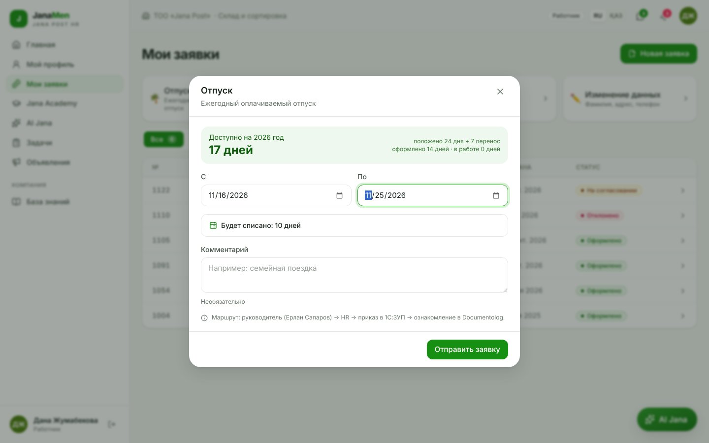</td>
<td>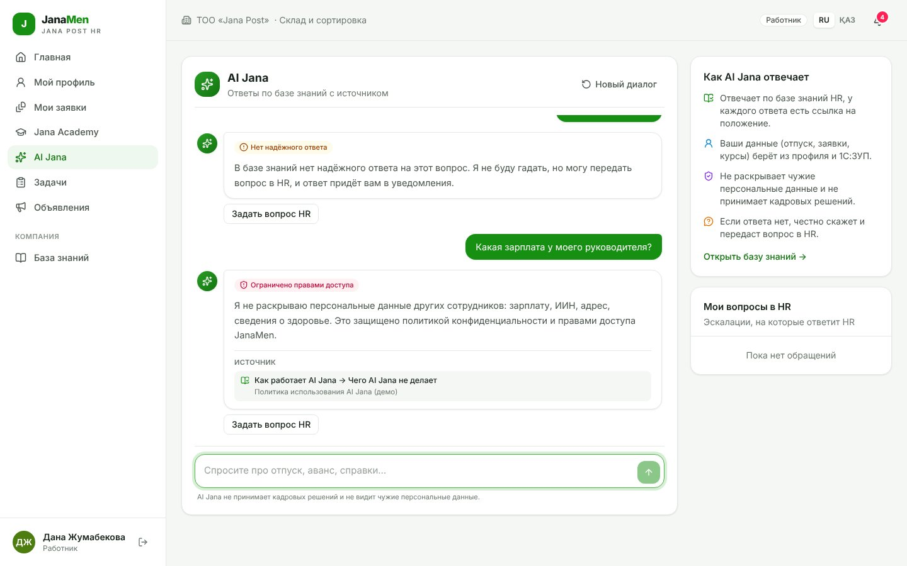</td>
</tr>
<tr>
<td>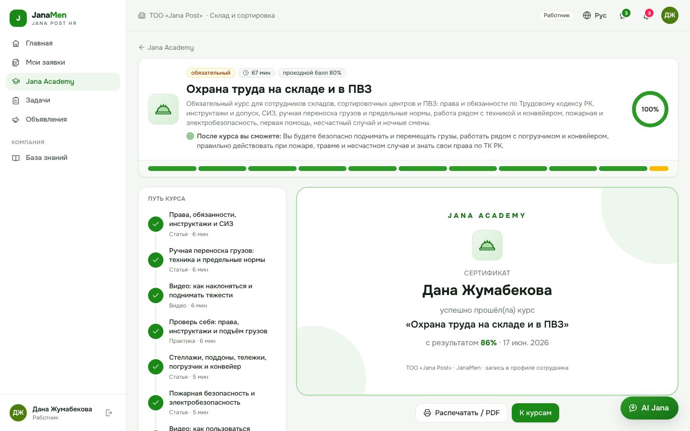</td>
<td>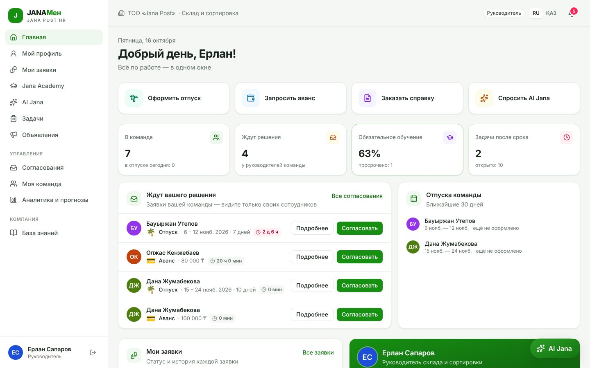</td>
</tr>
</table>

## Что умеет каждая роль

**Работник.** Главная «всё в одном окне»; профиль из 1С:ЗУП (личный телефон, адрес и контакт на экстренный случай
можно изменить сам, официальные данные — через заявку «Изменение данных»); заявки: отпуск, аванс, справка с места
работы, изменение данных — с отменой, историей и документами; Jana Academy; задачи и объявления; центр уведомлений;
AI Jana; база знаний.

**Руководитель.** Всё, что у работника, плюс: согласование заявок команды в один клик (отказ — с комментарием),
таймер ожидания и «поторопить», «Моя команда» (отсутствия, обучение, задачи), назначение задач и курсов,
объявления для своего подразделения, аналитика команды, AI Jana отвечает цифрами по команде.

**HR / администратор — кабинет «Пульс компании».** Тот же интерфейс, но с обзором на всю компанию:

- **Главная:** KPI — численность, заявки в работе, среднее время согласования, % обязательного обучения, использование
  отпусков, % вопросов без ответа AI Jana; графики заявок по неделям, отпусков по месяцам с прогнозом на 3 месяца
  (пунктир), обучения по отделам, численности по подразделениям.
- **Зона внимания** — люди и действие в один клик: отпуск копится > 30 дней → «Напомнить», курс просрочен →
  «Напомнить», заявка у руководителя > 48 ч → «Поторопить», новичок без онбординга → «Назначить курс».
- **Сотрудники:** поиск, фильтры (подразделение, работает / в отпуске / новичок), ⭐ «Слежу» — список наблюдения на
  главной и уведомления HR о заявках, курсах и просрочках этих людей; карточка сотрудника — профиль из 1С, трек заявок,
  курсы и баллы, задачи, кнопки «Назначить курс» и «Поставить задачу».
- **Заявки — канбан** «У руководителя → У HR → В 1С:ЗУП → Готово» с таймером на этапе, оформлением в один клик и
  документом Documentolog в карточке.
- **Аналитика и прогнозы:** тепловая карта отпусков «месяц × отдел», воронка обучения и прогноз даты 100 %, время на
  каждом этапе заявки (узкое место), что спрашивают у AI Jana и чего не хватает в базе знаний, логистика и нагрузка
  (поток посылок, SLA, прогноз на 45 дней и потребность в персонале), выгрузка в Excel. Прогнозы строятся по тренду и
  сезонности годовой истории и везде подписаны «прогноз».
- **Обращения в HR:** очередь эскалаций из AI Jana; ответ уходит сотруднику и по галочке пополняет базу знаний.
- **Интеграции:** синхронизация сотрудников из 1С:ЗУП, журнал событий outbox, обработка очереди.

<table>
<tr>
<td>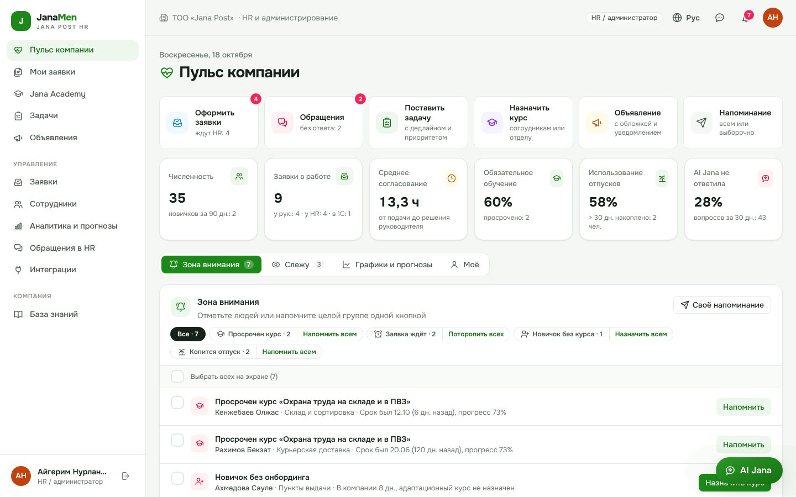</td>
<td>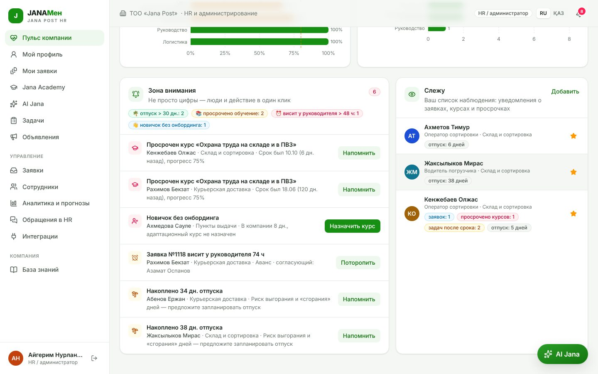</td>
</tr>
<tr>
<td>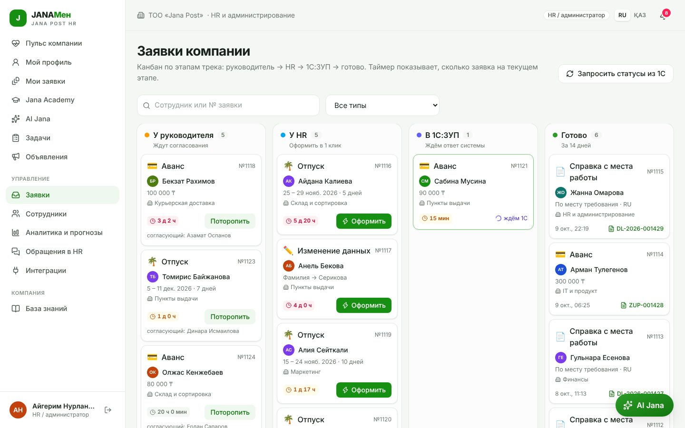</td>
<td>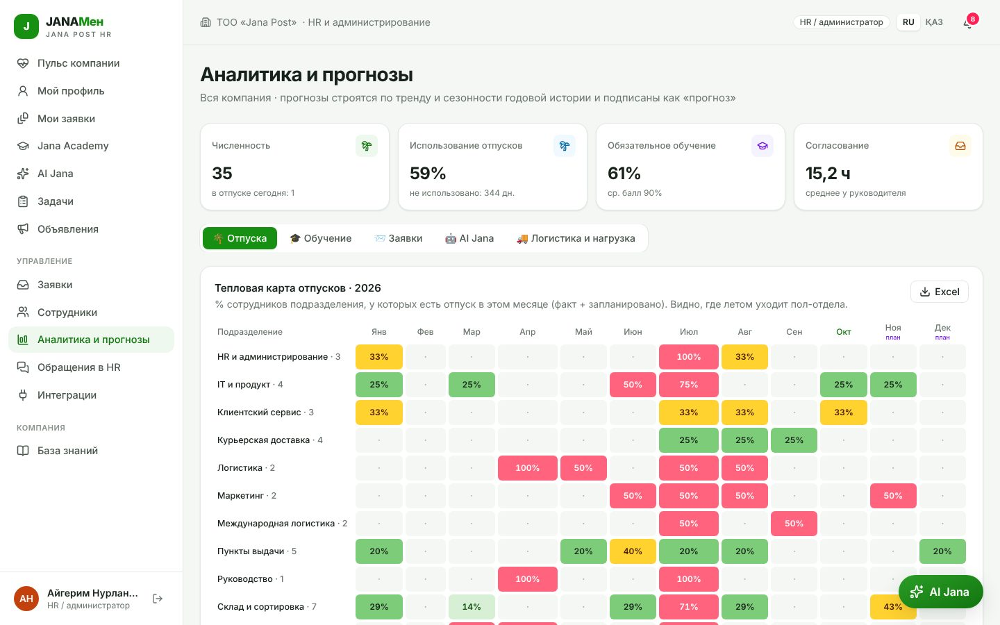</td>
</tr>
<tr>
<td>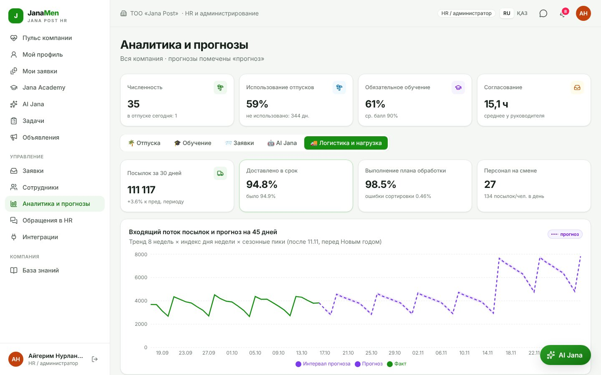</td>
<td>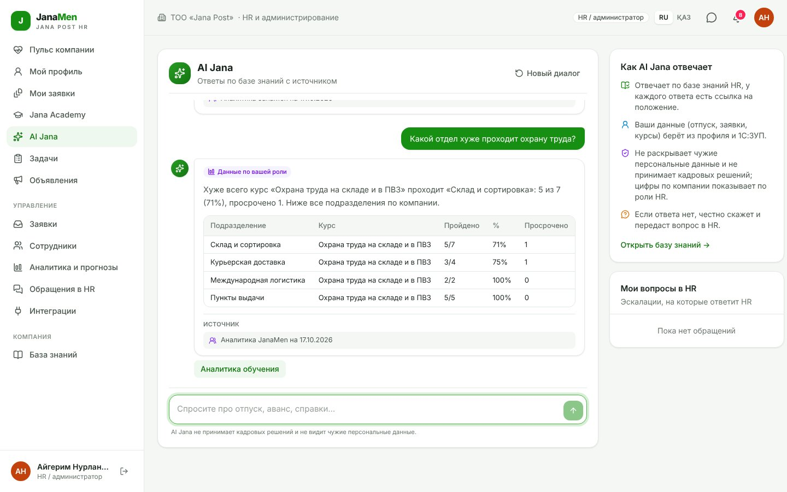</td>
</tr>
</table>

## AI Jana

AI Jana есть у всех трёх ролей и работает в двух режимах — интерфейс и правила одинаковые.

| | LLM-режим (`ANTHROPIC_API_KEY` задан) | Режим базы знаний (без ключа) |
|---|---|---|
| Где | серверная функция `api/ai-jana.ts` (Vercel или Docker-шлюз) | в браузере, `src/lib/assistant/engine.ts` |
| Как | Claude с инструментами: `search_knowledge_base`, `get_my_data`, `company_analytics` | полнотекстовый поиск по базе знаний + распознавание типовых намерений |
| Ответ | свободный текст строго по результатам инструментов, ссылки `[1]` на фрагменты | готовые фрагменты статей и личные/аналитические данные |

Правила, которые соблюдаются в обоих режимах:

- **Только по базе знаний.** Кадровые правила берутся из утверждённых статей (`kb_articles`, 18 статей с указанием
  документа-источника). Сервер принимает ответ «по базе знаний» только если модель сослалась на реально найденный
  фрагмент; выдуманная ссылка превращает ответ в «нет надёжного ответа».
- **Источник у каждого ответа** — документ и раздел; по клику открывается статья.
- **Честное «не знаю» + эскалация** в HR одной кнопкой.
- **Права доступа те же, что у пользователя.** Все запросы инструментов идут в Supabase с JWT пользователя, поэтому
  модель физически не видит чужие данные: работнику — только свои, руководителю — цифры по команде, HR — по компании.
  Статьи «для руководителей» и «для HR» скрыты от остальных политикой RLS.
- **Не раскрывает персональные данные** других сотрудников и **не принимает кадровых решений**.
- **Учится на эскалациях:** ответ HR на обращение одной галочкой становится новой статьёй базы знаний.
- Технически: структурированный вывод (JSON Schema), отказ модели (`stop_reason: refusal`) обрабатывается, включены
  серверные fallback-модели, системный промпт кешируется; при любой ошибке LLM клиент автоматически переходит в режим
  базы знаний.

Примеры: работник — «Сколько у меня дней отпуска?», «Как оформить аванс?», «Что делать на больничном?»;
руководитель — «Кто в отпуске на следующей неделе?»; HR — «У кого больше 30 дней отпуска?»,
«Какой отдел хуже проходит охрану труда?»; вне базы — «Когда корпоратив?».

## Интеграции с 1С:ЗУП и Documentolog

Промышленные интеграции в MVP не требуются, поэтому внешние системы — **mock-адаптеры с тем же контрактом событий**,
а точки подключения показаны и в коде, и в интерфейсе (раздел «Интеграции» у HR).

- **1С:ЗУП → JanaМен (входящий поток).** Сотрудники, должности, подразделения, руководители, даты приёма, оклад.
  `sync_from_zup()` переносит изменения из `mock_zup` (схема-заглушка 1С); раздел «Интеграции» показывает, что
  изменилось с последней синхронизации. Официальные данные в JanaМен — **только чтение** (триггер запрещает менять их
  даже HR; изменить можно через заявку «Изменение данных»).
- **JanaМен → 1С:ЗУП и Documentolog (исходящий поток).** Когда HR оформляет заявку, в той же транзакции в таблицу
  `integration_events` (transactional outbox) пишутся события: приказ об отпуске / выплата аванса / изменение данных →
  1С:ЗУП; лист ознакомления / справка → Documentolog. Воркер доставляет события адаптерам, сохраняет внешние номера
  документов и переводит заявку в «Готово»; ошибка доставки оставляет событие в очереди со статусом `error`.
- **Как подключить реальные системы:** заменить `mock_zup_call` / `mock_documentolog_call` на вызовы HTTP-сервиса 1С
  (OData / REST) и API Documentolog в воркере (Supabase Edge Function или отдельный сервис по cron/очереди);
  `sync_from_zup` — на выгрузку из 1С по расписанию или webhook. Контракт события и UI не меняются.
  Подробно, с примерами payload, — в [docs/ARCHITECTURE.md](docs/ARCHITECTURE.md#интеграции).

## Архитектура

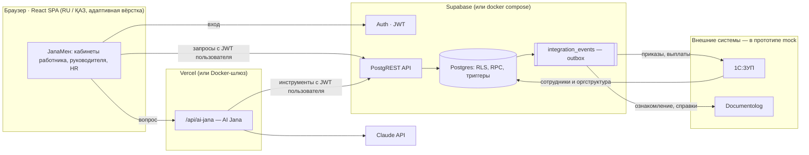

- **Бизнес-логика и права — в базе.** Политики RLS на каждой таблице, изменения состояния только через RPC
  (`decide_request`, `submit_quiz`, `answer_ticket`, …) с явной проверкой роли, триггеры-«стражи» на официальных данных,
  журнал изменений `audit_log`. Обойти правила, вызывая API напрямую, нельзя.
- **Фронтенд:** React 19 + TypeScript + Vite, Tailwind CSS v4, TanStack Query, React Router, Recharts, RU/ҚАЗ-словарь.
- **AI:** Claude API через `@anthropic-ai/sdk` (tool runner), запросы инструментов — от имени пользователя.
- **Два способа развёртывания из одного кода:** Supabase Cloud + Vercel или `docker compose` (Postgres + GoTrue +
  PostgREST + Node-шлюз). Конфигурация во время выполнения (`/config.js`) позволяет одной сборке работать в обоих.

Подробнее — диаграммы последовательности, модель данных, контракт интеграций, устройство AI Jana и прогнозов:
**[docs/ARCHITECTURE.md](docs/ARCHITECTURE.md)**.

## Роли и права доступа

Ограничения работают на уровне базы данных (RLS + проверки в RPC), интерфейс лишь скрывает недоступное.

| Данные | Работник | Руководитель | HR / администратор |
|---|---|---|---|
| Рабочий профиль коллег (ФИО, должность, подразделение) | ✓ | ✓ | ✓ |
| Персональные данные (ИИН, оклад, дата рождения, адрес) | только свои | только свои | все |
| Изменение официальных данных 1С:ЗУП | ✗ (заявка) | ✗ (заявка) | ✗ — только синхронизация из 1С; HR меняет лишь роль доступа |
| Заявки | свои | свои + своей команды (вся цепочка подчинения) | все |
| Согласование / оформление заявок | ✗ | согласовать / отклонить заявки команды | согласовать, оформить в 1С, отклонить |
| Обучение: прогресс и результаты | свои | своей команды | все |
| Ключи ответов тестов | ✗ | ✗ | ✗ (баллы считает только сервер) |
| Аналитика и прогнозы | ✗ | по команде | по компании |
| Статьи базы знаний | общие | общие + для руководителей | все |
| Обращения в HR и вопросы к AI Jana | свои | свои | все (очередь эскалаций) |
| Уведомления | свои | свои | свои |
| «Слежу», зона внимания, интеграции, синхронизация с 1С | ✗ | ✗ | ✓ |

## Что реализовано, что смоделировано, что дальше

| Контур | Статус | Комментарий |
|---|---|---|
| Единый вход, 3 роли, права на уровне БД | ✅ реализовано | Supabase Auth + RLS + RPC; самостоятельная регистрация выключена |
| Личный кабинет | ✅ реализовано | все поля из кейса + задачи, объявления, уведомления |
| HR-сервис: отпуск, аванс, справка, изменение данных | ✅ реализовано | статусы, история, отмена, проверки на сервере, документы |
| Мои заявки | ✅ реализовано | список с фильтрами, карточка, трек этапов |
| Согласование руководителем, оформление HR, канбан | ✅ реализовано | таймер ожидания, «поторопить», один клик |
| Jana Academy | ✅ реализовано | 4 курса, уроки, тест с серверной проверкой, сертификат, назначение, просрочки |
| AI Jana | ✅ реализовано | LLM-режим и режим базы знаний, источники, эскалация, обучение базы |
| Центр уведомлений | ✅ реализовано | заявки, обучение, задачи, объявления, «Слежу»; Realtime в облаке |
| «Пульс компании», аналитика, прогнозы, Excel | ✅ реализовано | прогнозы — статистические (тренд × сезонность), подписаны «прогноз» |
| Задачи и объявления | ✅ реализовано | руководитель/HR назначают, исполнитель меняет только статус |
| RU / ҚАЗ | ✅ реализовано частично | навигация и ключевые экраны работника на казахском; статьи базы знаний — на русском |
| Адаптивная веб-версия | ✅ реализовано | мобильная навигация, проверено на 390 px |
| Docker | ✅ реализовано | `docker compose up --build` |
| 1С:ЗУП | 🟡 смоделировано | mock-схема `mock_zup`, синхронизация, исходящие события через outbox |
| Documentolog | 🟡 смоделировано | mock-адаптер, номера документов, печатные формы-заглушки |
| Электронная подпись, хранение оригиналов | ⏭ дальнейшее развитие | вне рамок MVP по условиям кейса |
| Реальные адаптеры 1С / Documentolog, SSO (AD / eGov) | ⏭ дальнейшее развитие | контракт событий уже готов |
| Рекрутинг, Performance Management, опросы вовлечённости | ⏭ дальнейшее развитие | модульная схема БД позволяет добавлять разделы |
| Push-уведомления, мобильное приложение, Telegram-бот AI Jana | ⏭ дальнейшее развитие | |
| Казахская версия базы знаний, семантический поиск (эмбеддинги) | ⏭ дальнейшее развитие | |

## Безопасность и данные

- **Нет реальных персональных данных:** сотрудники, ИИН, телефоны и документы вымышленные (домен `jana.test`).
- **Нет секретов в репозитории:** ключи — только в переменных окружения (`.env.example` — шаблон без значений);
  Docker-стек генерирует JWT-секрет и пароли при первом запуске. Пароль `Jana2026!` — публичный пароль тестовых
  аккаунтов демо-стенда.
- **Права — в базе:** RLS на всех таблицах, RPC с проверкой роли (`SECURITY DEFINER` + явные проверки), запрет прямых
  изменений официальных данных, оклада и ИИН, серверная проверка тестов, журнал изменений.
- **Учётная запись привязывается к карточке сотрудника** по рабочей почте только после её подтверждения — чтобы
  регистрация с чужим адресом не могла «занять» карточку; самостоятельная регистрация выключена.
- **AI Jana** работает с правами пользователя и не видит того, что пользователю недоступно.

## Тесты

| Команда | Что проверяет |
|---|---|
| `npm run build` | проверка типов TypeScript и production-сборка |
| `npm run test:api` | 57 проверок через публичный API от имени тестовых пользователей: RLS (работник видит только своё, руководитель — только команду, оклады скрыты), сквозная заявка (создание → согласование → оформление → 1С → «Готово» → история и уведомления), лимиты отпуска и аванса, курс и тест, поиск по базе знаний и «нет ответа», эскалация → новая статья, аналитика, синхронизация с 1С, задачи |
| `npm run test:e2e` | прогон в браузере (Playwright) всех ролей и мобильной версии со скриншотами каждого шага |

```bash
# API-тест: укажите стенд (Docker: адрес http://localhost:8080, ключ — из http://localhost:8080/config.js)
SUPABASE_URL=https://<ref>.supabase.co SUPABASE_ANON_KEY=<anon> npm run test:api
# E2E: npm i --no-save playwright && npx playwright install chromium
E2E_BASE_URL=http://localhost:8080 npm run test:e2e
```

Тесты создают заявки и обращения — после прогона сбросьте данные (`supabase/seed.sql` или `SEED=always docker compose up -d init`).

## Примечание: пожелания команды

| Пожелание | Где в продукте |
|---|---|
| Окна заявок на аванс и отпуск | быстрые сервисы на главной, «Мои заявки», модальные формы с расчётом и маршрутом |
| Логистика, объявления, задачи — у сотрудников | «Задачи» (ставит руководитель/HR; категории: логистика, склад, доставка, обучение и др.), «Объявления» (для всех или для подразделения), блоки на главной; у HR — раздел «Логистика и нагрузка» с прогнозом |
| Входной экран со всей информацией и заданиями | главная «всё в одном окне»: профиль, отпуск, заявки, обучение, задачи, объявления, уведомления |
| AI-ассистент для обычных вопросов | AI Jana — у всех трёх ролей, плавающая кнопка на каждом экране |
| HR видит всех сотрудников и следит за нужными | «Сотрудники» с фильтрами и ⭐ «Слежу», карточка сотрудника, уведомления по наблюдаемым |
| У главного — логистика, проценты, продвижение, прогнозы, графики | «Пульс компании» и «Аналитика и прогнозы»: KPI, графики, тепловая карта, воронка, прогнозы, логистика, Excel |

## Структура репозитория

```
api/ai-jana.ts            серверная функция AI Jana (Vercel; в Docker — через шлюз)
src/
  pages/                  экраны: главная, профиль, заявки, академия, AI Jana, канбан, сотрудники, аналитика…
  components/             UI-кит, графики, блоки HR, формы и карточки заявок, чат ассистента
  lib/                    API-хуки (TanStack Query), auth, i18n RU/ҚАЗ, локальный движок AI Jana, форматирование
supabase/
  migrations/             схема, RLS, заявки, академия и AI, задачи, аналитика, интеграции (7 миграций)
  seed.sql                демо-данные (повторный запуск = сброс стенда)
  setup.sql               миграции + seed одним файлом для SQL Editor (npm run db:setup-sql)
docker/, Dockerfile,
docker-compose.yml        локальный стек: Postgres + Auth + PostgREST + Node-шлюз
tests/                    api-smoke.mjs (57 проверок), e2e-walkthrough.mjs (Playwright)
docs/                     ARCHITECTURE.md, PRESENTATION.md, скриншоты
```

---

Сделано для Jana Post на хакатоне Terricon Valley · октябрь 2026.
