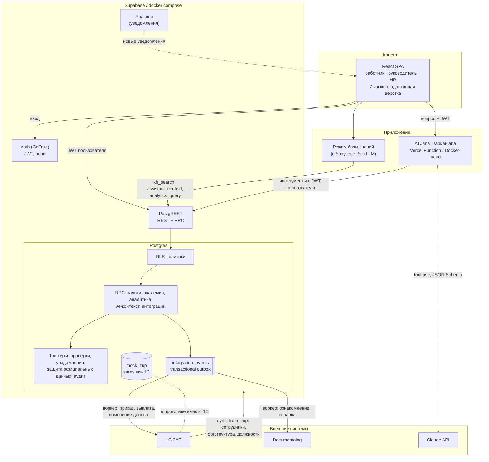
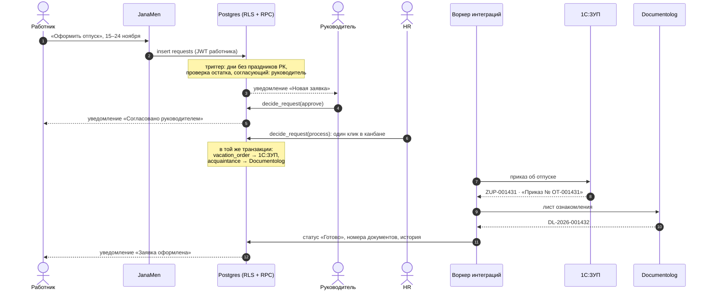
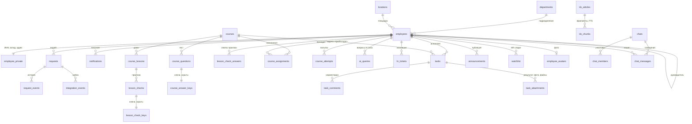
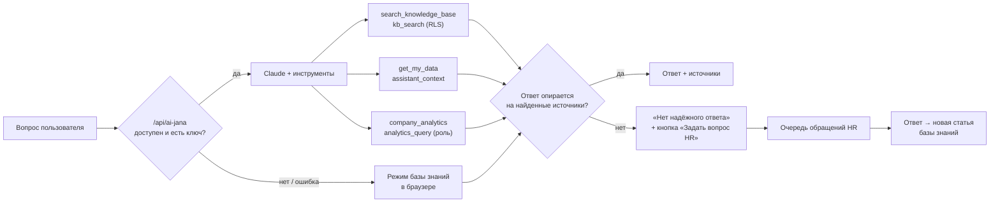

# Архитектура JanaMen

Документ описывает, как устроен прототип и где подключаются внешние системы: 1С:ЗУП, Documentolog и языковая модель.

## Принципы

1. **Права в базе данных, а не в интерфейсе.** Каждая таблица под Row Level Security; изменения состояния
   только через RPC-функции с явной проверкой роли; официальные кадровые данные защищены триггерами. Любой клиент
   (SPA, AI Jana, будущие мобильное приложение или бот) получает ровно те данные, что положены пользователю.
2. **1С:ЗУП остаётся мастер-системой кадровых данных.** JanaMen читает и показывает официальные данные, но не меняет их;
   изменения уходят в 1С событиями.
3. **Интеграции через transactional outbox.** Событие для внешней системы пишется в той же транзакции, что и
   бизнес-операция, поэтому заявка не может «потеряться» между JanaMen и 1С.
4. **AI без доверия к модели.** Ассистент получает данные только через инструменты с правами пользователя, а сервер
   проверяет, что ответ опирается на найденные источники.
5. **Один код, два способа развёртывания:** Supabase Cloud + Vercel или `docker compose`.

## Компоненты



| Компонент | Технологии | Ответственность |
|---|---|---|
| SPA | React 19, TypeScript, Vite 7, Tailwind CSS 4, TanStack Query, React Router, Recharts | кабинеты трёх ролей, формы, графики, 7 языков |
| Auth | Supabase Auth (GoTrue) | вход по почте и паролю, JWT; регистрация выключена, учётки создаёт HR |
| API | PostgREST | REST над таблицами и RPC; права через JWT-роль и RLS |
| База | Postgres 16+ | 28 таблиц, RLS, ~50 RPC-функций, триггеры, полнотекстовый поиск (русская морфология) |
| AI Jana | Vercel Function, `@anthropic-ai/sdk` (tool runner) | ответы по базе знаний, личным данным и аналитике |
| Интеграции | outbox + адаптеры | доставка событий в 1С:ЗУП и Documentolog |

## Сквозной сценарий: заявка на отпуск



Статусы заявки: `pending` (у согласующего) → `approved` (у HR) → `processing` (в 1С:ЗУП) → `done`;
а также `rejected` (только с комментарием) и `cancelled` (работником до оформления). Справка и изменение данных идут
сразу к HR. Каждый переход пишет событие в `request_events` (история в карточке) и уведомления участникам; канбан HR и
таймеры ожидания строятся по этим событиям.

Проверки на сервере: остаток отпуска (с учётом заявок в работе и переноса прошлого года), праздничные дни,
аванс ≤ 50 % оклада и не чаще раза в месяц, нельзя согласовать собственную заявку, руководитель согласует только
свою команду, оформление в 1С доступно только HR.

## Модель данных



| Группа | Таблицы |
|---|---|
| Оргструктура (из 1С:ЗУП, только чтение) | `employees`, `employee_private`, `departments`, `locations`, `holidays` |
| HR-сервис | `requests`, `request_events`, `integration_events`, `notifications` |
| Jana Academy | `courses`, `course_lessons` (статья / видео / практика), `lesson_checks`, `lesson_check_keys`, `lesson_check_answers`, `course_questions`, `course_answer_keys`, `course_assignments`, `lesson_progress`, `course_attempts` |
| AI Jana | `kb_articles`, `kb_chunks` (tsvector, русская морфология + триграммы), `ai_queries`, `hr_tickets` |
| Работа команды | `tasks` (тип, дедлайн `due_at`, чек-лист, результат, отзыв проверяющего), `task_comments`, `task_attachments`, `announcements` (анонс, обложка, фото), `announcement_reads` |
| HR-аналитика | `watchlist`, `reminders`, `logistics_daily`, `audit_log` |
| Профиль и сообщения | `employee_avatars` (фото 256×256 data URL), `chats`, `chat_members`, `chat_messages` |

`employee_private` вынесена отдельно, чтобы рабочий профиль коллег (ФИО, должность, подразделение) был виден всем,
а персональные данные только самому сотруднику и HR.

Переписку читают только участники чата (`is_chat_member`), даже HR. Писать можно только функциями `send_message`,
`open_direct_chat`, `create_group_chat`, `mark_chat_read`; `chat_list` отдаёт чаты пользователя с непрочитанными.
Новые сообщения приходят через Realtime, в Docker-стеке списки обновляются опросом.

## Роли и права

Роль хранится в `employees.role` (`employee` / `manager` / `hr`) и проверяется функциями `is_hr()`,
`is_manager_of(target)` (рекурсивно по цепочке подчинения) и `current_employee_id()`.

| Механизм | Что защищает |
|---|---|
| RLS `select` | свои данные; команда руководителю; всё HR; статьи базы знаний по уровню доступа |
| RLS `insert/update/delete` | создать заявку можно только от своего имени; задачи себе, команде или (HR) кому угодно; объявления публикует HR или руководитель для своего подразделения |
| RPC с проверками | `decide_request`, `cancel_request`, `submit_quiz`, `complete_lesson` (практика только после верных ответов), `answer_lesson_check`, `assign_course`, `assign_tasks`, `review_task`, `answer_ticket`, `sync_from_zup`, `attention_action`, `attention_bulk`, `send_reminder`, аналитика (`require_analytics_access`) |
| Триггеры-стражи | официальные поля сотрудника, ИИН, оклад и дата рождения не меняются через API; исполнитель задачи меняет только ход выполнения: статус, отметки чек-листа и результат; задачу с отчётом закрывает только постановщик, задачу «пройти курс» только сдача теста, чек-лист только когда отмечены все шаги |
| Привилегии | ключи ответов тестов, служебные функции (`notify`, адаптеры, воркер outbox) недоступны клиенту |
| Аудит | изменения карточек сотрудников пишутся в `audit_log` |

Регистрация в Auth выключена; учётная запись привязывается к карточке сотрудника по рабочей почте только после
подтверждения адреса.

## Интеграции

### Входящий поток: 1С:ЗУП → JanaMen

`sync_from_zup()` сравнивает карточки с источником (в прототипе это схема `mock_zup`, имитирующая выгрузку 1С),
добавляет новых сотрудников, обновляет должности, подразделения, руководителей, даты приёма и пишет входящие события в
журнал. `zup_pending_changes()` показывает HR, что изменилось с последней синхронизации.

В промышленной версии: регламентная выгрузка из 1С:ЗУП (HTTP-сервис или OData) по расписанию или по событию,
сопоставление по табельному номеру (`zup_id`).

### Исходящий поток: JanaMen → 1С:ЗУП и Documentolog

Когда HR оформляет заявку, `enqueue_request_integration()` в той же транзакции создаёт события:

| Тип заявки | 1С:ЗУП | Documentolog |
|---|---|---|
| Отпуск | `vacation_order`: приказ об отпуске | `acquaintance`: ознакомление с приказом |
| Аванс | `advance_payment`: ведомость на выплату | нет |
| Изменение данных | `employee_change`: изменение карточки | нет |
| Справка с места работы | нет | `certificate`: справка |

Пример события и ответа адаптера (как они лежат в `integration_events`):

```json
{
  "system": "1c_zup",
  "direction": "outbound",
  "entity": "vacation_order",
  "payload": {
    "request_number": 1103,
    "employee_tab_no": "JP-0009",
    "employee": "Цой Карина Олеговна",
    "type": "vacation",
    "start_date": "2026-10-26",
    "end_date": "2026-11-04",
    "days": 9
  },
  "status": "sent",
  "response": { "id": "ZUP-001419", "document": "Приказ о предоставлении отпуска № ОТ-001419 от 16.10.2026" }
}
```

Воркер (`process_integration_events`, в UI кнопка «Обработать очередь событий») берёт события `pending`, вызывает адаптер,
сохраняет внешний номер и документ, переводит заявку в «Готово» и уведомляет сотрудника; при ошибке событие получает
статус `error` с текстом ошибки и остаётся видимым в журнале.

**Как подключить реальные системы.** Заменить `mock_zup_call` и `mock_documentolog_call` на HTTP-вызовы API 1С:ЗУП и
Documentolog в воркере (Supabase Edge Function по cron или отдельный сервис, читающий очередь). Ключом
идемпотентности для внешней системы служит номер заявки из payload, внешний ID сохраняется в событии; формат событий,
статусы заявок и интерфейс не меняются.

## AI Jana



- **Поиск по базе знаний:** полнотекстовый (`tsvector`, русская морфология, веса заголовков) плюс триграммное
  сходство; надёжность оценивается долей совпавших значимых слов, ниже порога ответ «нет ответа».
- **LLM-режим:** системный промпт с правилами (только по инструментам, без выдуманных норм, без чужих персональных
  данных, без кадровых решений), структурированный ответ по JSON Schema (`status`, `answer`, `citations`).
  Сервер оставляет только ссылки на реально найденные фрагменты и понижает ответ без опоры до «нет ответа».
  Обрабатывается отказ модели (`stop_reason: refusal`), включены серверные fallback-модели, системный промпт кешируется.
- **Права:** инструменты вызывают Supabase с JWT пользователя, поэтому RLS и проверки в RPC действуют для модели так же,
  как для человека.
- **Личный контекст:** `assistant_context` отдаёт только данные текущего пользователя: профиль, остаток и ближайший
  отпуск, заявки, курсы со сроками, открытые задачи с дедлайном (время Алматы), приоритетом, постановщиком и прогрессом
  чек-листа, задачи на проверке у постановщика, ближайшие праздники и свежие объявления его подразделения. Поэтому
  AI Jana отвечает «что горит и с чего начать» без доступа к чужим задачам.
- **Журнал:** каждый вопрос пишется в `ai_queries` (статус, источники), на этом строится аналитика HR
  «что спрашивают и чего не хватает в базе знаний».

## Аналитика и прогнозы

Все функции аналитики работают по множеству `visible_employee_ids()`: HR видит компанию, руководитель свою команду.

| Показатель | Метод |
|---|---|
| Отпуска по месяцам, прогноз на 3 месяца | max(уже запланировано; тот же месяц год назад × тренд); тренд = дни отпуска за последние 6 полных месяцев ÷ за те же месяцы год назад, ограничен 0,5–2 |
| Дата 100 % обязательного обучения | оставшиеся назначения ÷ темп завершений за последние 28 дней |
| Логистика, прогноз на 45 дней | линейный тренд за 8 недель × индекс дня недели × сезонные пики (16–30.11 ×1,6; 10–28.12 ×1,3); интервал ±1,96σ остатков модели; нужно людей = прогноз ÷ выработка на человека в этот день недели (4 недели); доступно = обычная смена этого дня недели − отпуска логистики |
| Время на этапах заявки | среднее время этапа по событиям `request_events` (руководитель → HR → 1С) и по каждому руководителю; узкое место там, где среднее больше |
| Зона внимания | правила: отпуск > 30 дней, просроченный курс, заявка у руководителя > 48 ч, новичок без адаптационного курса |

Прогнозы статистические, а не «магические», и в интерфейсе подписаны «прогноз».

## Развёртывание

| | Supabase Cloud + Vercel | `docker compose up --build` |
|---|---|---|
| База, Auth, API | Supabase | Postgres 16 + GoTrue + PostgREST |
| SPA и `/api/ai-jana` | Vercel | Node-шлюз (`docker/server.mjs`), тот же код функции |
| Схема и данные | `supabase/setup.sql` или `supabase db push --include-seed` | init-контейнер применяет миграции и seed |
| Секреты | переменные окружения Vercel / Supabase | генерируются при первом запуске в docker-томе |
| Realtime-уведомления | да | обновление опросом раз в 45 секунд |

Фронтенд читает адрес API и публичный ключ из `/config.js` (Docker) или из переменных сборки `VITE_*` (Vercel),
поэтому одна и та же сборка работает в обоих вариантах.

## Расширяемость

- **Новые HR-модули** (рекрутинг, оценка, опросы): новые таблицы с теми же функциями ролей и RLS, новые разделы
  в навигации по ролям.
- **Новые типы заявок:** значение `type`, правила проверки в триггере, маршрут в `decide_request` и событие в outbox.
- **Новые каналы** (мобильное приложение, Telegram-бот AI Jana) работают через тот же API и ту же функцию AI Jana,
  права уже обеспечены базой.
- **Локализация: 7 языков** (русский, казахский, английский, кыргызский, узбекский на латинице, таджикский, монгольский).
  Словари по разделам в `src/locales/<язык>/`, русский исходный; TypeScript не соберёт проект, если в каком-то языке
  не хватает фразы, а `npm run check:i18n` находит текст вне словарей, лишние ключи, потерянные `{переменные}` и длинное
  тире. Русский встроен в сборку, остальные языки скачиваются отдельным файлом при выборе. Даты, время и числа
  выводятся по шаблонам каждого языка (`src/lib/format.ts`), без зависимости от данных локалей браузера. Тексты, которые
  пишет база (уведомления, ошибки, журнал заявок, ответы 1С), переводятся на клиенте по шаблонам (`src/lib/serverText.ts`).
  AI Jana распознаёт вопросы на всех языках (`src/lib/assistant/intents.ts`) и отвечает на языке интерфейса: режим базы
  знаний берёт фразы из `src/locales/*/jana.ts`, LLM-режим получает `lang` и просит модель отвечать на нём. Статьи
  базы знаний, курсы и объявления остаются контентом на русском; вопрос на другом языке ищется по русскому запросу его
  темы. Новый язык: папка словарей, строка в `src/locales/langs.ts`, загрузчик в `i18n.tsx`, выражения в `intents.ts`
  и название языка в `api/ai-jana.ts`.
